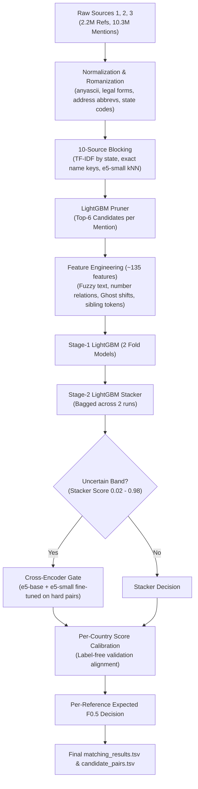

# Amazon ML Challenge 2026: Business Entity Resolution

[](https://www.amazon.science/)
[](#team)
[](#leaderboard-progression)
[](#leaderboard-progression)
[](LICENSE)

An end-to-end, high-precision machine learning solution for resolving noisy multi-source business entity records to ground-truth real-world enterprises under severe label noise, distractor entities, and missing references.

---

## 🏆 Results & Highlights

- **Public Leaderboard $F_{0.5}$:** **`0.983`** (Top Tier)
- **Test-Like Dense Validation $F_{0.5}$:** **`0.9899`**
- **Progression:** `0.943` $\rightarrow$ `0.950` $\rightarrow$ `0.965` $\rightarrow$ `0.973` $\rightarrow$ `0.975` $\rightarrow$ `0.976` $\rightarrow$ `0.982` $\rightarrow$ **`0.983`**
- **Strict Compliance:** Only MIT-licensed models with $\le 278\text{M}$ parameters (`multilingual-e5-base`, `multilingual-e5-small`, `LightGBM`). **Zero external datasets or web lookups.**

---

## 📌 Problem Overview

Business Entity Resolution requires linking noisy business listings from three distinct data sources:
- **Reference Records (Source 1):** The deduplicated canonical set of distinct real-world businesses. Each row in `matching_results.tsv` corresponds to one Reference Record.
- **Mentions (Source 2 & Source 3):** Noisy, perturbed observations (spelling corruptions, legal suffix variations, token permutations, address abbreviations, Indic scripts). Each Mention links to at most one Reference Record.
- **Distractors & Ghosts:** ~26% of Mentions match *no* Reference Record. **Ghosts** are adversarial-like distractors that mimic legitimate businesses (identical core name, shifted house numbers $+1\text{ to }+60$, mutated legal suffix such as Inc $\rightarrow$ Corp).
- **Metric:** Macro $F_{0.5}$ across all Reference Records (weights precision twice as heavily as recall; singletons must predict empty to score 1.0).

---

## 🧠 Key Technical Innovations

1. **Test-Like Density & Orphan Simulation:**
   Test data exhibits 5.76 Mentions/Reference vs. 4.67 in training (a ~19% orphan distractor rate). Training directly on naive samples creates an artificial 0.03 score gap. By hashing and dropping a fixed 19% of training Reference Records, models were trained and validated under exact test-like distractor density.
2. **Ghost Distractor Discrimination:**
   Engineered ~135 specialized pair features including signed house number differences, digit-edit relationships (truncation vs. upward shift), token replacement frequencies (sibling words), and Reference-level candidate cluster statistics.
3. **Multi-View Blocking (10 Sources):**
   State-partitioned char 3-gram and word TF-IDF, consonant skeletons, city $\rightarrow$ state inference, exact order-free name keys, and exact cosine similarity kNN using `multilingual-e5-small` embeddings. Pruned via LightGBM down to the top-6 candidates per Mention.
4. **Stacked Model Architecture & Bagging:**
   Two-stage LightGBM pipeline: Stage 1 out-of-fold fold models generate pairwise probabilities, followed by a Stage 2 Stacker that models candidate competition (ranks, score gaps, sum of candidate probabilities per entity). Two 15% sample stacker runs were bagged.
5. **Cross-Encoder Gate on Hard Uncertain Pairs:**
   Two fine-tuned cross-encoders (`multilingual-e5-base` and `multilingual-e5-small`) trained specifically on the uncertain decision band (stacker probability $0.02 - 0.98$). The gate decides keep/drop on the stacker's top candidate, delivering the largest single late leap (**0.976 $\rightarrow$ 0.983**).
6. **Unsupervised Metric-Aware Calibration:**
   Without labels, test score distributions were calibrated per country against the dense validation profile to derive optimal $F_{0.5}$ thresholds and per-Reference prefix decisions.

---

## 🔄 End-to-End Pipeline Architecture



---

## 📊 Leaderboard Progression

| Version | Key Innovation / Major Change | Validation $F_{0.5}$ | Public Leaderboard $F_{0.5}$ |
| :---: | :--- | :---: | :---: |
| **v2s** | Baseline TF-IDF + Multilingual-e5 Embedding Blocking + Stacker | 0.9769 (sparse) | 0.943 |
| **v4** | Sibling-word mutation rates + France region thresholds | 0.9793 (sparse) | 0.950 |
| **v6** | Ghost house-number shift features & candidate cluster context | 0.9887 (sparse) | 0.965 |
| **v9** | Dense full-corpus training + exact-key blocking + name uniqueness | 0.9869 (dense) | 0.973 |
| **v9cal** | Unsupervised per-country threshold calibration | 0.9869 (dense) | 0.975 |
| **v12ef** | Test-like density (19% simulated orphan references) + Expected $F_{0.5}$ decision | 0.9855 (dense, orphaned) | 0.976 |
| **v16gate** | Bagged stackers + Cross-encoder gate (3 models, easy pairs) | 0.9891 (dense, orphaned) | 0.982 |
| **Final** | **Cross-encoder gate fine-tuned on hard in-band pairs (base + small)** | **0.9899** | **0.983** |

---

## 📁 Repository Structure

```
amazon_ml_challenge_2026/
├── code/business_entity_resolution/    # Core pipeline implementation
│   ├── src/
│   │   ├── ber/                        # Normalization, blocking, embeddings, features, stacker
│   │   │   ├── normalize.py            # anyascii romanization, legal forms, address cleaners
│   │   │   ├── block.py                # State-partitioned TF-IDF & exact key blocking
│   │   │   ├── embed_knn.py            # multilingual-e5 GPU cosine kNN
│   │   │   ├── features.py             # Rapidfuzz, numbers, context features
│   │   │   ├── ghost.py                # Ghost house number shifts & cluster signals
│   │   │   ├── sibling.py              # Sibling word mutation rates
│   │   │   ├── stack.py                # Stage-2 competition context features
│   │   │   ├── resolve.py              # 1-to-1 solver & thresholding
│   │   │   ├── evaluate.py             # Macro F0.5 metric evaluation
│   │   │   └── pipeline.py             # Feature extraction & training orchestrator
│   │   ├── final/                      # Final ensemble & decision pipeline
│   │   │   ├── orphan.py               # 19% missing reference simulation
│   │   │   ├── ce_export.py            # Export text pairs for cross-encoder
│   │   │   ├── hard_export.py          # Hard pair mining (stacker score 0.02 - 0.98)
│   │   │   ├── bag.py                  # Average multiple stacker models
│   │   │   ├── ce_gate.py              # Out-of-fold cross-encoder gate classifier
│   │   │   ├── calibrate_test_ef.py    # Per-country calibration & final TSV generation
│   │   │   └── efdecide.py             # Expected F0.5 prefix selection
│   │   └── kaggle/                     # GPU kernel runners (embedding & cross-encoders)
│   ├── scripts/                        # Automation & validation scripts
│   │   ├── make_split.py               # Geographic state-level holdout split
│   │   ├── train_dense.py              # Full-density training runner
│   │   ├── score_test.py               # Scoring & prediction script
│   │   └── validate_submission.py      # Official competition format validator
│   ├── tests/                          # 58 comprehensive unit & integration tests
│   └── requirements.txt                # Pinned dependencies
├── docs/                               # Architecture Decision Records (ADRs)
├── submission/                         # Packaged submission
│   ├── Slytherin_submission.zip        # Complete submission package (Git LFS)
│   │   ├── output/matching_results.tsv # Final predicted entity matches
│   │   ├── output/candidate_pairs.tsv  # Top-6 pruned candidate pairs
│   │   ├── code/...                    # Standalone reproducible code
│   │   └── Documentation_template.md   # Final technical report
│   └── pkg/                            # Unpacked clean submission code
├── CONTEXT.md                          # Domain terminology & entity resolution definitions
├── Documentation_template.md           # Full technical submission document
├── FINDINGS.md                         # Detailed experimental notes & ablations
├── ps.txt                              # Problem statement details
├── .env.example                        # Template for API credentials
└── .gitignore                          # Rules excluding raw datasets & 270GB run artifacts
```

---

## ⚙️ Setup & Installation

### Requirements
- **OS:** Windows / Linux / macOS
- **Python:** `3.11` to `3.13`
- **Compute:**
  - CPU steps: $\ge 16\text{ GB RAM}$, multi-threaded CPU.
  - GPU steps: Kaggle $2\times\text{T4}$ or local GPU with $\ge 16\text{ GB VRAM}$ (for `multilingual-e5` embeddings and cross-encoders).

### Installation
```bash
# Clone the repository (with Git LFS for submission archives)
git clone https://github.com/sathwik7993/amazon_ml_challenge_2026.git
cd amazon_ml_challenge_2026

# Install Git LFS hooks
git lfs install
git lfs pull

# Create virtual environment
python -m venv .venv
source .venv/bin/activate  # On Windows: .venv\Scripts\Activate.ps1

# Install dependencies
pip install -r code/business_entity_resolution/requirements.txt
```

---

## 🚀 Reproduction Walkthrough

Set environment variables from repository root:
```bash
export PYTHONPATH=code/business_entity_resolution/src
S=code/business_entity_resolution/scripts
F=code/business_entity_resolution/src/final
DATA=student_resource/dataset
```

1. **Geographic Validation Split (held-out states):**
   ```bash
   python $S/make_split.py --train-dir $DATA/train --out data/split --frac 0.10 --seed 7
   ```
2. **Dense Embeddings (GPU):**
   Run [`code/business_entity_resolution/src/kaggle/embed/embed_kernel.py`](code/business_entity_resolution/src/kaggle/embed/embed_kernel.py) on Kaggle $2\times\text{T4}$ to compute cosine top-10 candidate pairs for training and test sets.
3. **Simulate Test Density (19% Orphan References):**
   ```bash
   python $F/orphan.py runs/v9/work runs/v12/work data/emb/emb_full.parquet data/emb/emb_full_orph.parquet data/split/val/source1.tsv
   ```
4. **Train Dense Stage-1 & Stage-2 Models:**
   ```bash
   python $S/train_dense.py --data $DATA/train --work runs/v12/work --emb data/emb/emb_full_orph.parquet --from-train runs/sample/work --val-refs data/split/val/source1.tsv --sample 0.15
   ```
5. **Cross-Encoder Gate Fine-Tuning & Inference:**
   - Export hard pairs with `$F/hard_export.py`.
   - Fine-tune `multilingual-e5-base` and `multilingual-e5-small` via [`src/kaggle/ce_hard_base`](code/business_entity_resolution/src/kaggle/ce_hard_base) and [`src/kaggle/ce_hard_small2`](code/business_entity_resolution/src/kaggle/ce_hard_small2).
   - Fit gate logistic regression with `$F/ce_gate.py`.
6. **Calibration & Final Submission Output:**
   ```bash
   python $F/calibrate_test_ef.py
   ```
7. **Verify Submission Compliance:**
   ```bash
   python $S/validate_submission.py --submission submission/Slytherin_submission.zip --dataset $DATA
   ```

---

## 👥 Team: Slytherin

- **Sathwik Chappala** — *CMR College of Engineering & Technology*
- **Bojja Mahendra Sai** — *CMR College of Engineering & Technology*

---

## 📄 License & Compliance

All code in this repository is licensed under the [MIT License](LICENSE).
All external pretrained models (`intfloat/multilingual-e5-base`, `intfloat/multilingual-e5-small`, `LightGBM`) are strictly MIT-licensed, parameter-compliant ($\le 278\text{M} \ll 8\text{B}$), and used without external datasets.
